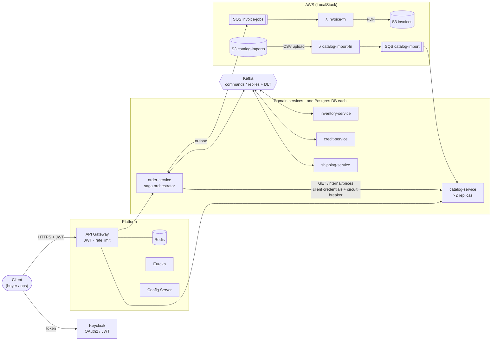
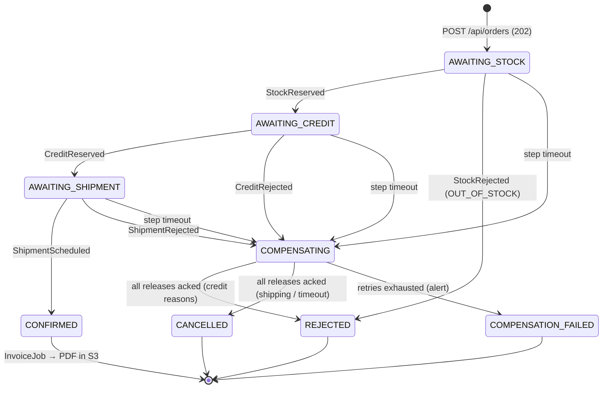

# OrderFlow

[](https://github.com/dougles/microservices-orderflow/actions/workflows/ci.yml)


[](LICENSE)

**A B2B wholesale ordering system built with Spring Boot microservices, Kafka and AWS (via LocalStack). The point of the project is resilience: every failure it claims to handle is backed by an automated test.**

A buyer from a client company places an order against the catalog at their company's prices. The order then reserves stock, takes from the company's credit line and books a delivery slot. Once it is confirmed, a Lambda renders a PDF invoice to S3. When any step fails (out of stock, credit exceeded, a service down, Kafka down, a late reply), the saga compensates and the system ends in a consistent state.

## Highlights

- **Orchestrated saga** with compensation, per-step timeouts, compensation retries and handling of late or duplicate replies.
- **Transactional outbox + inbox**: at-least-once delivery with effectively-once processing. No message is lost between the DB commit and Kafka.
- **Idempotent API**: an `Idempotency-Key` on `POST /api/orders` makes client retries safe, including concurrent retries.
- **Circuit breaker** (Resilience4j) on the synchronous pricing call, plus per-company **rate limiting** at the gateway (Redis).
- **Multi-tenant security**: Keycloak JWTs are validated at the gateway *and* in every service. The tenant always comes from the token, and other tenants' data returns `404`.
- **Dead-letter topics** with an ops replay endpoint, plus SQS DLQs with Prometheus alerts.
- **Serverless on AWS**: S3-triggered CSV catalog import and SQS-driven PDF invoicing, both as Java Lambdas.
- **Full observability**: JSON logs → ELK, metrics → Prometheus/Grafana, and distributed traces → Jaeger. A single trace spans gateway → order → inventory/credit/shipping, even across Kafka.
- **20 failure scenarios** ([`docs/FAILURES.md`](docs/FAILURES.md)) define "done". Each one is a test that injects the failure (paused containers, poison messages, concurrent races) and checks the outcome.

## Architecture



Every service registers with Eureka and pulls its config from Config Server. Observability (Prometheus, Grafana, Jaeger, Elasticsearch, Kibana, Filebeat) is left out of the diagram for readability.

### Order saga

`order-service` drives each order through this state machine. Commands and replies travel over Kafka through the outbox and inbox. Each transition runs in one DB transaction under a row lock.



Every `Release*` / `CancelShipment` command is idempotent on the receiving side. When a release arrives before its reservation, the receiver leaves a *tombstone*, so a late reservation is rejected or undone instead of leaking stock or credit.

## Tech stack

| Area | Technology |
|---|---|
| Language / build | Java 25 (Lambdas on 21), Maven multi-module, no Lombok |
| Framework | Spring Boot 4.0, Spring Cloud 2025.1 (Gateway, Config, Eureka, LoadBalancer, Resilience4j), Spring Cloud AWS 4.2 |
| Messaging | Apache Kafka (KRaft), Amazon SQS |
| Data | PostgreSQL (database per service), Flyway, Redis |
| Security | Keycloak, OAuth2 resource server / client credentials |
| AWS | S3, SQS and Lambda on LocalStack, AWS SDK v2, PDFBox |
| Observability | Micrometer, OpenTelemetry → Jaeger, Prometheus + Grafana, ELK + Filebeat |
| Testing | JUnit 5, Testcontainers (Postgres, Kafka, LocalStack), WireMock, Awaitility, REST Assured |
| Runtime | Docker Compose (~20 containers) |

## Quick start

**Requirements:** Docker with Compose v2, JDK 25, `curl` and `jq` (the repo's Claude Code hooks need it too). The machine needs at least 16 GB of RAM (32 GB recommended).

```bash
git clone https://github.com/dougles/microservices-orderflow.git && cd microservices-orderflow

cp deploy/.env.example deploy/.env      # replace every "cambiar-en-local" with your own value
./mvnw -q package -DskipTests           # images copy the jars built here
docker compose -f deploy/docker-compose.yml up -d --build --wait

./deploy/demo.sh                        # guided walkthrough (DEMO_PAUSE=1 pauses between steps)
```

The demo script takes a JWT for each test user. It then places an order and checks idempotency, follows the saga to `CONFIRMED`, checks that the invoice PDF landed in S3, triggers a credit-limit rejection, shows tenant isolation, and prints links to the trace and the dashboards.

| UI | URL | Login |
|---|---|---|
| API Gateway | http://localhost:8080 | JWT |
| Keycloak | http://localhost:8180 | `admin` / your `KEYCLOAK_ADMIN_PASSWORD` |
| Eureka | http://localhost:8761 | — |
| Grafana (dashboard "OrderFlow") | http://localhost:3000 | `admin` / `admin` |
| Prometheus (alerts) | http://localhost:9090/alerts | — |
| Jaeger | http://localhost:16686 | — |
| Kibana | http://localhost:5601 | — |

Test users (password = username, local only): `buyer-acme`, `buyer-globex`, `buyer-initech`, `ops`.

<details>
<summary>Calling the API by hand</summary>

```bash
TOKEN=$(curl -s localhost:8180/realms/orderflow/protocol/openid-connect/token \
  -d grant_type=password -d client_id=orderflow-cli -d username=buyer-acme -d password=buyer-acme | jq -r .access_token)

curl -s -X POST localhost:8080/api/orders \
  -H "Authorization: Bearer $TOKEN" -H "Idempotency-Key: $(uuidgen)" -H 'Content-Type: application/json' \
  -d '{"deliveryDate":"2026-12-20","items":[{"sku":"SKU-0001","quantity":5}]}'
# → 202 {"orderId":"…","status":"PENDING"}

curl -s localhost:8080/api/orders/<orderId> -H "Authorization: Bearer $TOKEN" | jq
```

`deliveryDate` must fall between tomorrow and 60 days from today. Errors use RFC 9457 `application/problem+json` with a `code` field (`VALIDATION_ERROR`, `UNKNOWN_SKU`, `IDEMPOTENCY_KEY_REUSED`, `CATALOG_UNAVAILABLE`, …).
</details>

<details>
<summary>Troubleshooting</summary>

- **Some services stay in `Created`:** Compose sometimes treats the `kafka-init` exit as a failed dependency. Run `up -d` again.
- **`503` right after startup:** the gateway caches the Eureka registry, so wait a few seconds after the services turn healthy.
- **Port 5432 already in use:** stop any local Postgres first.
</details>

## Failure scenarios (the definition of done)

Each row is one test class (`F07InventoryDownE2E`, `F13ConcurrentLastUnitIT`, …). The full table with exact setup and time limits is in [`docs/FAILURES.md`](docs/FAILURES.md).

| ID | Scenario | Expected outcome | Level |
|---|---|---|---|
| F00 | Happy path | `CONFIRMED`; stock, credit and delivery slot updated; PDF in S3 | E2E |
| F01 | Same `Idempotency-Key` sent 4× (2 concurrent) | Same `orderId` every time, exactly 1 order | IT |
| F02 | Same key, different body | `422 IDEMPOTENCY_KEY_REUSED` | IT |
| F03 | Out of stock | `REJECTED` / `OUT_OF_STOCK`, nothing reserved | E2E |
| F04 | Credit limit exceeded | `REJECTED`, stock released | E2E |
| F05 | No delivery capacity | `CANCELLED`, stock and credit released | E2E |
| F06 | Duplicate Kafka message | Effect applied once, one reply | IT |
| F07 | Inventory service paused | Step timeout → `CANCELLED`, nothing leaked | E2E |
| F08 | Credit replies *after* the timeout | Late reservation is released | E2E |
| F09 | Crash between DB commit and publish | Outbox publishes exactly once on restart | IT |
| F10 | Poison message / DB down while consuming | Goes to DLT, ops replay processes it | IT |
| F11 | Kafka down | API still returns `202`; order confirms after recovery | E2E |
| F12 | Catalog down | `503` in ≤ 3 s, then the circuit opens (< 100 ms); key not burned | E2E |
| F13 | 10 concurrent orders for the last unit | Exactly 1 wins, stock never negative | IT |
| F14 | Invoice Lambda fails | Message in DLQ, Prometheus alert FIRING | E2E |
| F15 | CSV with invalid rows | Valid rows imported, error report written to S3 | E2E |
| F16 | Cross-tenant access | `404`; ops can see everything | IT |
| F17 | One company floods the API | That company gets `429`, the others are unaffected | E2E |
| F18 | Distributed trace | One Jaeger trace spans all 5 services | E2E |
| F19 | A release is never acknowledged | Retries, then `COMPENSATION_FAILED` + metric | IT |

## Tests

| Type | Suffix | What it uses | Command |
|---|---|---|---|
| Unit (17 classes) | `*Test` | No Spring context, no containers | `./mvnw verify` |
| Integration (24 classes) | `*IT` | `@SpringBootTest` + real Postgres/Kafka/LocalStack via Testcontainers | `./mvnw verify` |
| End-to-end (12 classes) | `*E2E` | The full Compose stack, with faults injected via `docker compose pause/stop` | see below |

```bash
./mvnw verify                                                         # unit + integration (runs in CI)

ORDERFLOW_PROFILE=e2e docker compose -f deploy/docker-compose.yml up -d --build --wait
./mvnw -pl e2e-tests verify -Pe2e                                     # E2E, short timeouts profile
```

Integration tests never use slices, H2, embedded Kafka or a mocked `KafkaTemplate`, and no test may use `@Disabled`, assumptions or `Thread.sleep`. A hook enforces these rules.

## Repository layout

```
contracts/           Kafka & SQS message records + topic/queue names (shared, JDK only)
messaging-lib/       Outbox publisher, inbox, Kafka error handling, DLT replay
gateway/             Spring Cloud Gateway: routing, JWT, Redis rate limiter
config-server/       Native config backed by config-repo/
discovery-server/    Eureka
order-service/       Orders API, idempotency, saga orchestrator, invoice job producer
catalog-service/     Products, per-company pricing, internal price API, CSV import consumer
inventory-service/   Stock reservations
credit-service/      Credit line reservations
shipping-service/    Delivery capacity
invoice-fn/          Lambda: SQS → PDF → S3
catalog-import-fn/   Lambda: S3 CSV → validation → SQS
e2e-tests/           Black-box tests against the Compose stack
deploy/              docker-compose.yml, Keycloak realm, Grafana/Prometheus, LocalStack init, demo.sh
docs/                Spec, failure catalog, phases, ADRs
```

## How it was built

OrderFlow was built with [Claude Code](https://claude.com/claude-code) under a spec-first workflow. The design docs are in Spanish:

- [`docs/SPEC.md`](docs/SPEC.md) is the frozen spec: every API, topic, queue, state and config value.
- [`docs/FAILURES.md`](docs/FAILURES.md) is the failure catalog. It is the only definition of done.
- [`docs/PHASES.md`](docs/PHASES.md) is the delivery plan (5 phases, one commit per item).
- [`docs/adr/`](docs/adr) holds the design changes, each proposed by the agent and accepted by a human.
- `.claude/` has hooks that block edits to the frozen files and reject weakened tests, plus one skill per pattern (outbox, saga step, Kafka consumer, Lambda, …).

To work on it with Claude Code, run `claude` at the repo root and start with `Empieza la fase actual.` Use one phase per session (`/clear` in between) and review the test diffs in every commit. Claude cannot edit the spec, the failure catalog or `.claude/`. When it proposes an ADR, you accept it by editing those files yourself, or by starting a session with `ORDERFLOW_UNFREEZE=1 claude`.

## Known limitations

These are accepted on purpose for a local-only v1 (see SPEC §17). Kafka runs a single broker with RF 1, and Keycloak runs in dev mode. Consumer retries block their partition for about 7 s. Concurrent catalog imports follow last-write-wins. Lambda logs stay outside ELK.

## License

[MIT](LICENSE)
